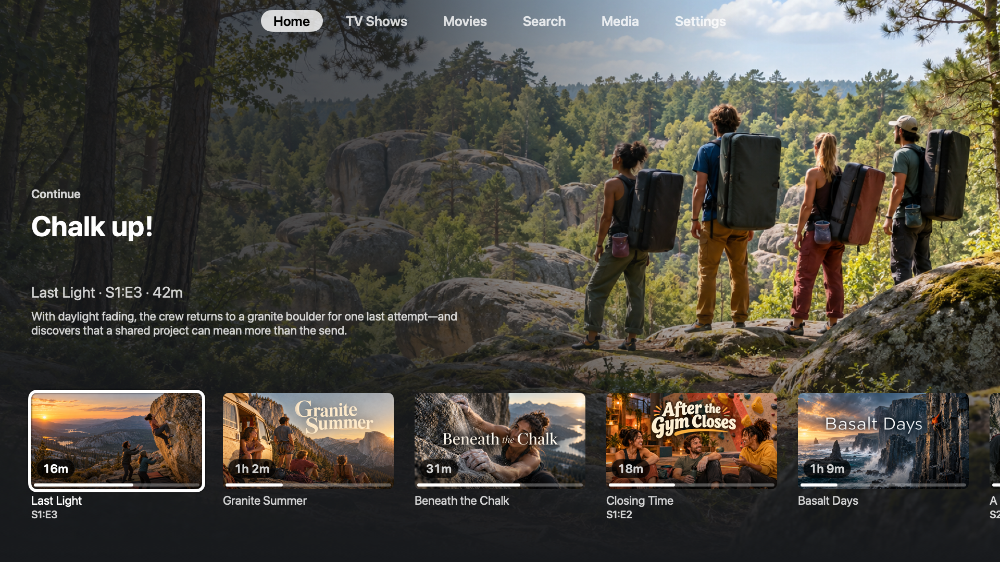
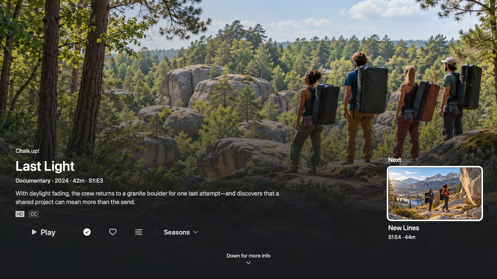
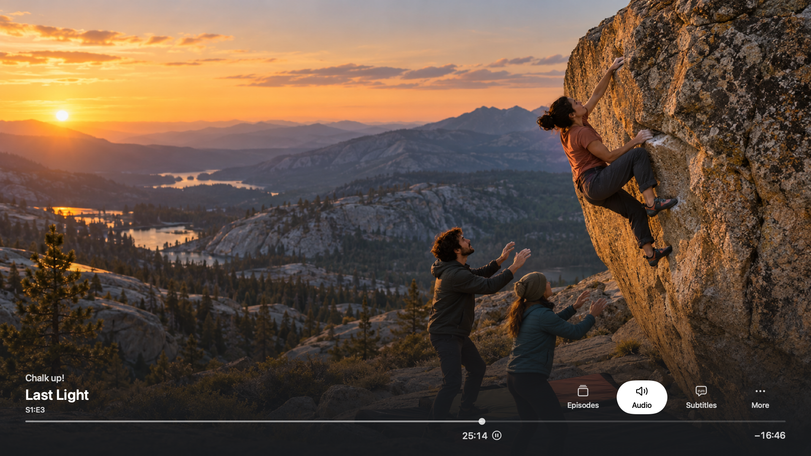
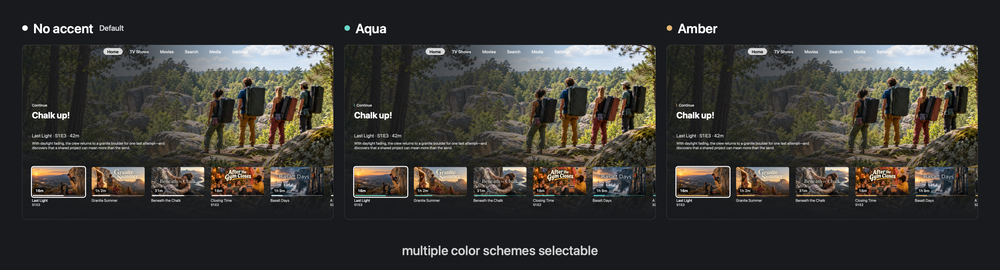

  

# Alphane

Alphane is a Jellyfin client for Apple TV, built on Swiftfin and redesigned to look, feel, and behave like a modern streaming app.

Compared with Swiftfin, Alphane focuses on:

- **Discovery:** cinematic Continue artwork and lazy-loaded recommendation rows with randomized categories and titles.
- **Remote navigation:** direct top navigation, clear focus outlines, consistent controls, and Back navigation that remembers your place.
- **Episode flow:** progress updates after playback and a next-episode action ready when an episode finishes.
- **Playback:** minimal cinema controls with quick access to audio and subtitles.
- **Apple TV Home Screen:** Continue and Next Up artwork through Top Shelf.

## Preview

These UI mockups use fictional climbing and bouldering films and series to avoid any copyright issues.

**Home** — cinematic artwork and progress for the selected Continue item.

**Dynamic sections** — discovery rows based on release decade, genre, and media type allow endless scrolling in the home screen.

**Episode finished** — the completed episode's detail page, with the next episode ready to play.

**Video UI** — cinema controls with quick access to episodes, audio, and subtitles.

## Build

To build, open `Alphane.xcodeproj` in Xcode and select the `Alphane tvOS` scheme. Local signing overrides belong in the ignored `XcodeConfig/DevelopmentTeam.xcconfig` file.

Report issues and follow development in [this repository](https://github.com/neogucky/alphane).

Alphane is a fork of [Swiftfin](https://github.com/jellyfin/Swiftfin), built by Jellyfin and its contributors, and retains its [Mozilla Public License 2.0](LICENSE.md) and source attribution.

